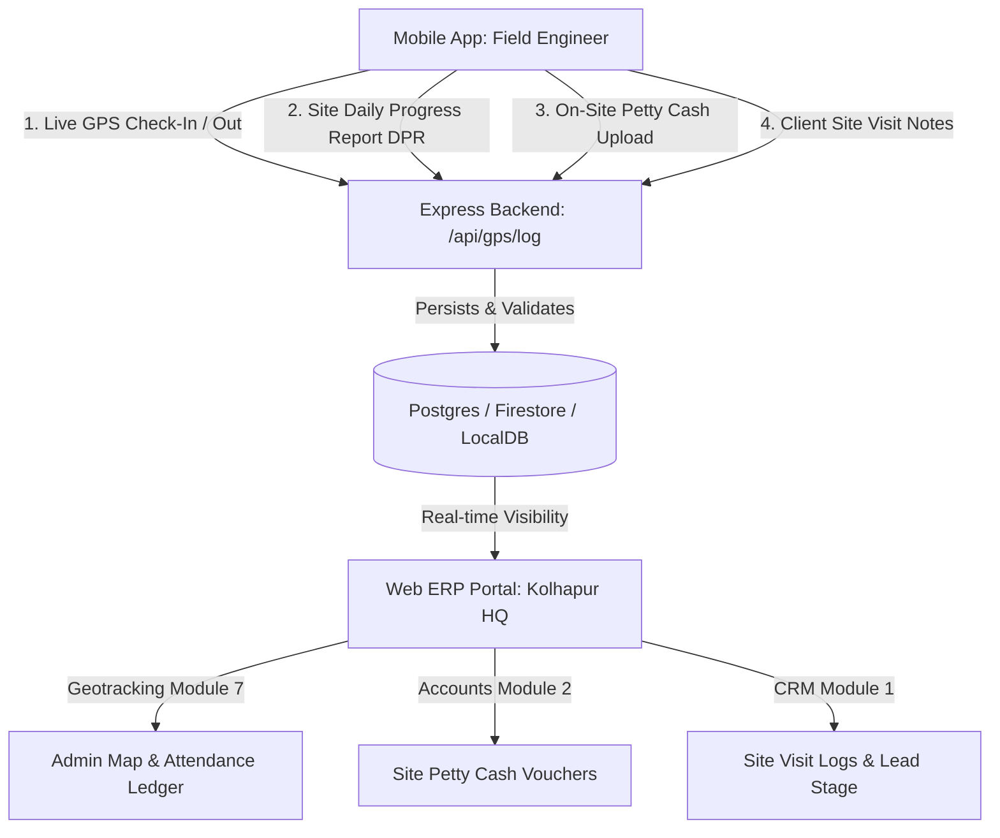

# 📱 SANMATI CONSTRUCTIONS ERP — MOBILE APPLICATION INTEGRATION GUIDE

> **Target Audience:** Flutter / React Native / Android Native Mobile Developers  
> **Backend Base URL:** `http://localhost:5000/api` (Local Dev) / `http://10.0.2.2:5000/api` (Android Emulator)  
> **Primary Purpose:** Field Operations, Employee GPS Geotracking, Daily Progress Reports (DPR), and On-Site Mobile Billing/CRM.

---

## 1. System Overview & Architecture

The Sanmati Constructions ERP system integrates a **Web Management Portal** (used by Head Office in Kolhapur, Accountants, Directors, and Project Managers) with a **Field Mobile Application** (used by Site Engineers, Supervisors, Surveyors, and Sales Representatives).

---

## 2. Employee Geotracking & Geofencing Protocol

### Geofence Verification Rule
Civil construction sites are geofenced with a latitude, longitude, and radius (meters).
1. When the employee taps **"Check-In"**, the mobile app accesses GPS satellites (`LocationAccuracy.high`).
2. The mobile app measures distance to the project site center using the **Haversine formula**.
3. If `distanceMeters <= geofenceRadius`, the check-in is flagged as **`Verified On-Site`**.
4. If `distanceMeters > geofenceRadius`, the check-in is flagged as **`Outside Geofence`** with an audit warning.
5. **Anti-Mock / Anti-Spoof:** Mobile app must check `isMockLocation == false` to prevent GPS faker apps.

### Active Construction Sites (Kolhapur Reference)
| Project ID | Project Name | Coordinates | Permitted Radius |
| :--- | :--- | :--- | :--- |
| `PRJ-KLP-001` | Royal Palace Commercial Complex (Kawala Naka) | `16.7029° N, 74.2404° E` | **250 meters** |
| `PRJ-KLP-002` | D.Y. Patil Medical Research Wing (Kasaba Bawada) | `16.7212° N, 74.2541° E` | **300 meters** |
| `PRJ-KLP-003` | MIDC Shiroli Heavy Logistics Hub (Shiroli MIDC) | `16.7451° N, 74.2811° E` | **400 meters** |

---

## 3. Offline-First Synchronization Strategy

Because construction basements, concrete tunnels, and remote quarry sites frequently experience cellular dead-zones:
1. Store all GPS logs, site photos, and DPRs in local **SQLite** (or **Hive**).
2. Listen to network state via `connectivity_plus` (Flutter) or `@react-native-community/netinfo`.
3. When internet connectivity resumes, automatically batch-sync pending records in the background.

---

## 4. Mobile Integration JSON Specification
For full JSON schema, API contracts, payload samples, and SQLite table definitions, refer directly to:  
👉 **[`MOBILE_DEVELOPER_INTEGRATION_SPEC.json`](file:///c:/sanmati_construction-main/MOBILE_DEVELOPER_INTEGRATION_SPEC.json)**
